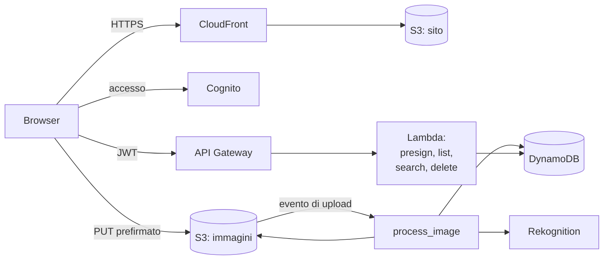

# serverless-image-gallery

[English](README.md) · [Português](README.pt-BR.md) · **Italiano**

Carica le tue foto, lascia che l'IA assegni loro dei tag e cercale per tag. Completamente serverless su AWS, interamente definito in Terraform e rilasciato con GitHub Actions.

Realizzato fase dopo fase durante la preparazione alla certificazione AWS Certified Cloud Practitioner (CLF-C02).

## Come funziona



1. L'utente accede tramite **Cognito** e riceve un token.
2. L'app chiede all'**API** un URL di caricamento e invia l'immagine **direttamente su S3**.
3. Il caricamento attiva **`process_image`**, che crea una miniatura e chiede a **Rekognition** le etichette dell'immagine.
4. Immagine e tag vengono salvati in **DynamoDB**, così la galleria può elencarli e cercarli.
5. Il sito stesso viene servito da un bucket privato tramite **CloudFront**.

## Tecnologie

| Livello | Servizi |
|---|---|
| Frontend | React, Vite, Tailwind, S3, CloudFront (OAC) |
| Autenticazione | User pool di Cognito, JWT authorizer di API Gateway |
| API e calcolo | API Gateway (HTTP API), Lambda (Python 3.13) |
| Archiviazione e dati | S3, DynamoDB (on-demand) |
| IA | Rekognition `DetectLabels` |
| Operatività | Allarmi CloudWatch, avvisi via e-mail con SNS |
| Rilascio | Terraform, GitHub Actions con OIDC |

## API

Tutte le rotte richiedono `Authorization: Bearer <access token>`.

| Rotta | Cosa fa |
|---|---|
| `POST /upload-url` | Restituisce un URL prefirmato, valido 5 minuti, per caricare un JPEG |
| `GET /images` | Elenca le tue immagini con i link alle miniature |
| `GET /images/search?tag=dog` | Elenca le tue immagini con quel tag |
| `DELETE /images/{id}` | Elimina l'immagine, la sua miniatura e i suoi tag |

## Struttura del progetto

```
backend/functions/      una cartella per ogni Lambda
frontend/               app React
infra/bootstrap/        configurazione iniziale: bucket per lo state, OIDC di GitHub, ruolo di deploy
infra/modules/          storage, compute, api, database, auth, cdn, monitoring
infra/environments/dev/ collega i moduli tra loro (è qui che si esegue Terraform)
.github/workflows/      controlli di CI e deploy automatico
docs/                   roadmap e appunti di studio
```

## Per iniziare

**Prerequisiti:** un account AWS, AWS CLI v2, Terraform 1.10+, Python 3.13, Node 24 e GitHub CLI.

1. **Collega la CLI al tuo account**
   ```bash
   aws configure --profile dev
   export AWS_PROFILE=dev        # PowerShell: $env:AWS_PROFILE = "dev"
   ```

2. **Bootstrap, da eseguire una sola volta** (bucket per lo state, provider OIDC, ruolo di deploy). Prima imposta `github_repo` in `infra/bootstrap/main.tf` con il tuo repository, nel formato GitHub `owner@owner_id/repo@repo_id`.
   ```bash
   terraform -chdir=infra/bootstrap init
   terraform -chdir=infra/bootstrap apply
   ```

3. **Aggiungi i secret su GitHub**
   ```bash
   gh secret set AWS_DEPLOY_ROLE_ARN --body "$(terraform -chdir=infra/bootstrap output -raw deploy_role_arn)"
   gh secret set ALERT_EMAIL
   ```

4. **Fai push su `main`.** Il workflow di Deploy prepara il layer di Pillow, esegue `terraform apply` e pubblica il sito. Conferma l'e-mail di SNS che riceverai per attivare gli avvisi.

5. **Apri il sito**
   ```bash
   terraform -chdir=infra/environments/dev output -raw site_url
   ```

### Avviare il frontend in locale

Copia `frontend/.env.example` in `frontend/.env.local`, compilalo con i valori di `terraform output`, poi esegui:

```bash
npm --prefix frontend install
npm --prefix frontend run dev    # http://localhost:5173
```

## CI/CD

| Workflow | Quando parte | Cosa fa |
|---|---|---|
| `CI` | a ogni push e pull request | Terraform fmt e validate, sintassi Python, build del frontend |
| `Deploy` | push su `main` | Accesso via OIDC, `terraform apply`, build e pubblicazione del frontend |

Su GitHub non è salvata nessuna chiave AWS: il ruolo di deploy si fida solo del branch `main` di questo repository.

## Sicurezza e costi

- Tutti i bucket sono privati. Il sito è raggiungibile solo tramite CloudFront, le immagini solo tramite URL prefirmati a breve scadenza.
- Ogni Lambda ha il proprio ruolo IAM, con le sole azioni e i soli prefissi S3 di cui ha bisogno.
- Ogni utente vede solo i propri dati: l'ID utente proviene dal token verificato, mai dalla richiesta.
- A riposo il costo è praticamente nullo: DynamoDB on-demand, log conservati 7 giorni, API con throttling e un avviso di budget sull'account.

## Documentazione

- [Roadmap](docs/roadmap.md)
- [What I've learned](docs/what-ive-learned.md): appunti per la CLF-C02 scritti durante il progetto (in inglese)

## Licenza

[MIT](LICENSE)
