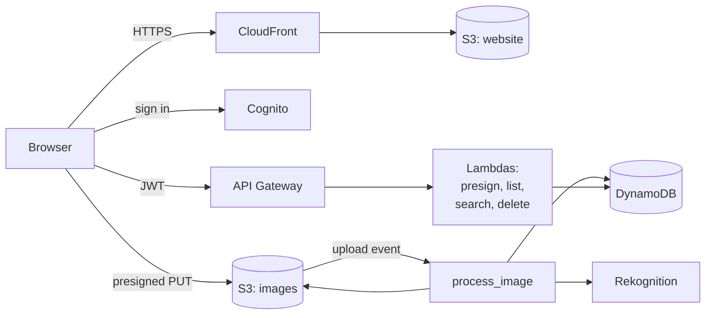

# serverless-image-gallery

**English** · [Português](README.pt-BR.md) · [Italiano](README.it.md)

Upload photos, get them tagged by AI, and search them by tag. Fully serverless on AWS, fully defined in Terraform, deployed by GitHub Actions.

Built phase by phase while studying for the AWS Certified Cloud Practitioner (CLF-C02).

## How it works



1. The user signs in with **Cognito** and gets a token.
2. The app asks the **API** for an upload URL, then sends the image **straight to S3**.
3. The upload triggers **`process_image`**: it makes a thumbnail and asks **Rekognition** for labels.
4. Image and tags are saved in **DynamoDB**, so the gallery can list and search them.
5. The website itself is served from a private bucket through **CloudFront**.

## Stack

| Layer | Services |
|---|---|
| Frontend | React, Vite, Tailwind, S3, CloudFront (OAC) |
| Auth | Cognito user pool, API Gateway JWT authorizer |
| API & compute | API Gateway (HTTP API), Lambda (Python 3.13) |
| Storage & data | S3, DynamoDB (on-demand) |
| AI | Rekognition `DetectLabels` |
| Operations | CloudWatch alarms, SNS email alerts |
| Delivery | Terraform, GitHub Actions with OIDC |

## API

All routes need `Authorization: Bearer <access token>`.

| Route | What it does |
|---|---|
| `POST /upload-url` | Returns a 5-minute presigned URL to upload one JPEG |
| `GET /images` | Lists your images with thumbnail links |
| `GET /images/search?tag=dog` | Lists your images with that tag |
| `DELETE /images/{id}` | Deletes the image, its thumbnail and its tags |

## Project layout

```
backend/functions/      one folder per Lambda
frontend/               React app
infra/bootstrap/        one-time setup: state bucket, GitHub OIDC, deploy role
infra/modules/          storage, compute, api, database, auth, cdn, monitoring
infra/environments/dev/ wires the modules together (the place you run Terraform)
.github/workflows/      CI checks and automatic deploy
docs/                   roadmap and study notes
```

## Getting started

**Prerequisites:** an AWS account, AWS CLI v2, Terraform 1.10+, Python 3.13, Node 24, and the GitHub CLI.

1. **Point the CLI at your account**
   ```bash
   aws configure --profile dev
   export AWS_PROFILE=dev        # PowerShell: $env:AWS_PROFILE = "dev"
   ```

2. **One-time bootstrap** (state bucket, OIDC provider, deploy role). First set `github_repo` in `infra/bootstrap/main.tf` to your repository, in GitHub's `owner@owner_id/repo@repo_id` format.
   ```bash
   terraform -chdir=infra/bootstrap init
   terraform -chdir=infra/bootstrap apply
   ```

3. **Add the GitHub secrets**
   ```bash
   gh secret set AWS_DEPLOY_ROLE_ARN --body "$(terraform -chdir=infra/bootstrap output -raw deploy_role_arn)"
   gh secret set ALERT_EMAIL
   ```

4. **Push to `main`.** The Deploy workflow builds the Pillow layer, runs `terraform apply`, and publishes the website. Confirm the SNS email you receive to get alerts.

5. **Open the site**
   ```bash
   terraform -chdir=infra/environments/dev output -raw site_url
   ```

### Run the frontend locally

Copy `frontend/.env.example` to `frontend/.env.local`, fill it from `terraform output`, then:

```bash
npm --prefix frontend install
npm --prefix frontend run dev    # http://localhost:5173
```

## CI/CD

| Workflow | Runs on | Does |
|---|---|---|
| `CI` | every push and pull request | Terraform fmt and validate, Python syntax, frontend build |
| `Deploy` | push to `main` | OIDC sign-in, `terraform apply`, build and publish the frontend |

No AWS keys are stored in GitHub: the deploy role trusts only this repository's `main` branch.

## Security and cost

- Every bucket is private. The website is reachable only through CloudFront; images only through short-lived presigned URLs.
- Each Lambda has its own IAM role with only the actions and S3 prefixes it needs.
- Users only ever see their own data: the user id comes from the verified token, never from the request.
- Idle cost is close to zero: on-demand DynamoDB, 7-day log retention, a throttled API, and a budget alert on the account.

## Docs

- [Roadmap](docs/roadmap.md)
- [What I've learned](docs/what-ive-learned.md): CLF-C02 notes written while building

## License

[MIT](LICENSE)
