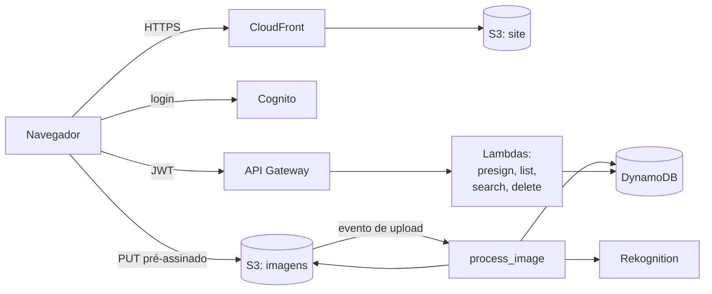

# serverless-image-gallery

[English](README.md) · **Português** · [Italiano](README.it.md)

Envie fotos, deixe a IA marcá-las com tags e pesquise por tag. Totalmente serverless na AWS, definido por completo em Terraform e publicado pelo GitHub Actions.

Construído fase a fase durante os estudos para a certificação AWS Certified Cloud Practitioner (CLF-C02).

## Como funciona



1. O usuário faz login pelo **Cognito** e recebe um token.
2. O app pede à **API** uma URL de upload e envia a imagem **direto para o S3**.
3. O upload dispara a **`process_image`**: ela gera uma miniatura e pede ao **Rekognition** as etiquetas da imagem.
4. A imagem e as tags são salvas no **DynamoDB**, para que a galeria possa listá-las e pesquisá-las.
5. O próprio site é servido a partir de um bucket privado, através do **CloudFront**.

## Tecnologias

| Camada | Serviços |
|---|---|
| Frontend | React, Vite, Tailwind, S3, CloudFront (OAC) |
| Autenticação | User pool do Cognito, JWT authorizer do API Gateway |
| API e computação | API Gateway (HTTP API), Lambda (Python 3.13) |
| Armazenamento e dados | S3, DynamoDB (sob demanda) |
| IA | Rekognition `DetectLabels` |
| Operação | Alarmes do CloudWatch, alertas por e-mail via SNS |
| Entrega | Terraform, GitHub Actions com OIDC |

## API

Todas as rotas exigem `Authorization: Bearer <access token>`.

| Rota | O que faz |
|---|---|
| `POST /upload-url` | Retorna uma URL pré-assinada, válida por 5 minutos, para enviar um JPEG |
| `GET /images` | Lista as suas imagens com links para as miniaturas |
| `GET /images/search?tag=dog` | Lista as suas imagens com essa tag |
| `DELETE /images/{id}` | Apaga a imagem, a miniatura e as tags |

## Estrutura do projeto

```
backend/functions/      uma pasta por Lambda
frontend/               app React
infra/bootstrap/        configuração única: bucket de state, OIDC do GitHub, role de deploy
infra/modules/          storage, compute, api, database, auth, cdn, monitoring
infra/environments/dev/ liga os módulos entre si (é aqui que você roda o Terraform)
.github/workflows/      verificações de CI e deploy automático
docs/                   roadmap e anotações de estudo
```

## Primeiros passos

**Pré-requisitos:** uma conta AWS, AWS CLI v2, Terraform 1.10+, Python 3.13, Node 24 e GitHub CLI.

1. **Aponte a CLI para a sua conta**
   ```bash
   aws configure --profile dev
   export AWS_PROFILE=dev        # PowerShell: $env:AWS_PROFILE = "dev"
   ```

2. **Bootstrap, feito uma única vez** (bucket de state, provedor OIDC, role de deploy). Antes, ajuste `github_repo` em `infra/bootstrap/main.tf` para o seu repositório, no formato `owner@owner_id/repo@repo_id` do GitHub.
   ```bash
   terraform -chdir=infra/bootstrap init
   terraform -chdir=infra/bootstrap apply
   ```

3. **Cadastre os secrets no GitHub**
   ```bash
   gh secret set AWS_DEPLOY_ROLE_ARN --body "$(terraform -chdir=infra/bootstrap output -raw deploy_role_arn)"
   gh secret set ALERT_EMAIL
   ```

4. **Faça push na `main`.** O workflow de Deploy gera a layer do Pillow, roda `terraform apply` e publica o site. Confirme o e-mail do SNS que você vai receber para passar a receber os alertas.

5. **Abra o site**
   ```bash
   terraform -chdir=infra/environments/dev output -raw site_url
   ```

### Rodar o frontend localmente

Copie `frontend/.env.example` para `frontend/.env.local`, preencha com os valores de `terraform output` e rode:

```bash
npm --prefix frontend install
npm --prefix frontend run dev    # http://localhost:5173
```

## CI/CD

| Workflow | Quando roda | O que faz |
|---|---|---|
| `CI` | a cada push e pull request | Terraform fmt e validate, sintaxe do Python, build do frontend |
| `Deploy` | push na `main` | Login via OIDC, `terraform apply`, build e publicação do frontend |

Nenhuma chave da AWS fica guardada no GitHub: a role de deploy só confia na branch `main` deste repositório.

## Segurança e custo

- Todos os buckets são privados. O site só é acessível pelo CloudFront, e as imagens só por URLs pré-assinadas de curta duração.
- Cada Lambda tem a sua própria IAM role, apenas com as ações e os prefixos do S3 de que precisa.
- Cada usuário só vê os próprios dados: o ID do usuário vem do token verificado, nunca da requisição.
- Parado, o custo é praticamente zero: DynamoDB sob demanda, logs retidos por 7 dias, API com throttling e alerta de orçamento na conta.

## Documentação

- [Roadmap](docs/roadmap.md)
- [What I've learned](docs/what-ive-learned.md): anotações para a CLF-C02 escritas durante o projeto (em inglês)

## Licença

[MIT](LICENSE)
